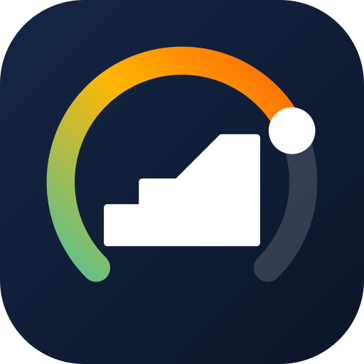

# bike-app

An Android app that controls a **Merach S29 Aura** exercise bike over Bluetooth LE. It shows live
ride stats, runs structured workouts by changing the bike's resistance automatically, reads heart rate
from a Pixel Watch, and keeps a history of your rides with pace targets.

**Status (2026-11-15):** the app builds, its 92 unit tests pass, and it runs on a phone. Verified on real
hardware: connecting, setting resistance, following the bike's own buttons, Pixel Watch 2 heart rate, and
importing workouts from the web builder. Ramps, pace targets, history numbers and the newest UI have been
checked in the emulator with a simulated bike, not yet on a ride. See
[`MerachRide/HANDOFF.md`](MerachRide/HANDOFF.md) for details.

## Why

Third-party apps have trouble connecting to this bike and changing resistance mid-ride, and Merach
publishes no protocol documentation. Probing the bike showed that it speaks the standard Bluetooth
**Fitness Machine Service (FTMS)**, so no reverse engineering was needed.

## Features

- One button connects the bike and your watch, with automatic reconnect, **Bike / Watch** status lights,
  and a foreground notification so rides continue with the screen off.
- Live power, cadence, level, speed (mph), heart rate, calories, distance and time on one screen.
- Set the level from the app or the bike's buttons; the app keeps them in sync.
- Built-in workouts, plus your own: segments that hold a level or **ramp** smoothly between levels.
  During a workout, **− / +** makes the rest of it easier or harder.
- Heart rate from a **Pixel Watch** (Connected Fitness) or any standard Bluetooth heart rate strap.
- A **pace target** from your last 5 rides of the same workout, with green ▲ / red ▼ arrows.
- A **simulated bike** in debug builds, for testing in the emulator without the real bike.
- A **web workout builder** ([`tools/workout-builder.html`](tools/workout-builder.html)) for making workouts
  on a computer. Open it in a browser, export `workouts.json`, and use **Import** on the app's Workouts tab.
- Ride history with per-ride stats (time, distance, kcal, speed, power, cadence, heart rate) and totals.
- A companion **watch app** (`MerachRide/wear/`, not yet built or tested) as a second way to get heart rate
  from a Pixel Watch; it starts on the watch when the bike connects.
- A **Report issue** button (in the connection log) that opens a pre-filled GitHub issue with the log.

## What's verified

Tested on the bike (2026-11-14):

| Action | Write to Control Point `0x2AD9` | Bike reply |
|---|---|---|
| Take control | `00` | `80 00 01` (success) |
| Start | `07` | `80 07 01` (success) |
| Set resistance level N (1–16) | `04 <N×10>`, e.g. `04 50` → level 8 | level changes on the bike's display |

- The bike accepts **resistance level only**. It has no target-power (ERG) control.
- It reports speed, cadence, distance, resistance (in whole levels), power, calories, heart rate and elapsed time.
- The bike's built-in screen does not block the phone from taking control.

## Repo layout

| Path | Contents |
|---|---|
| [`MerachRide/`](MerachRide/) | Android Studio project (Kotlin + Jetpack Compose). See [its README](MerachRide/README.md) for build and usage. |
| [`MerachRide/HANDOFF.md`](MerachRide/HANDOFF.md) | Project status, discovery log, open questions and next steps |
| [`tools/workout-builder.html`](tools/workout-builder.html) | Web workout builder: a single HTML page, no install needed |
| [`branding/`](branding/) | Logo (`logo.svg`, `logo-512.png`); the app icons are generated by `tools/icon/make_icon.py` |
| [`CLAUDE.md`](CLAUDE.md) | Notes for the AI coding assistant working on this repo |
| [`screenshots/`](screenshots/) | nRF Connect captures of the bike's Bluetooth services |

## Quick start

1. Clone the repo and open the `MerachRide` folder in Android Studio.
2. Connect an Android phone (8.0 or later) over USB or Wireless debugging, and press **Run**.
3. Close the Merach app, pedal to wake the bike, then **Scan for bikes** in the app and tap `MRK-S29C-…`.
4. Try the **Quick Test** workout. It steps through levels 2 → 8 → 16 → 1 in two minutes.
